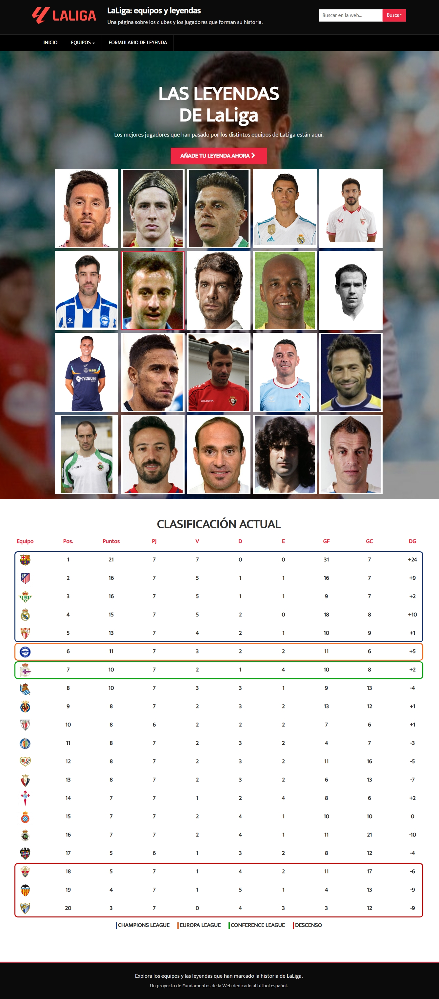
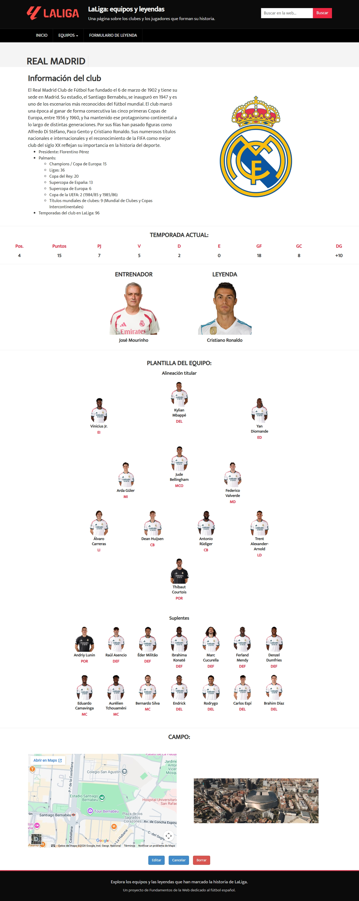
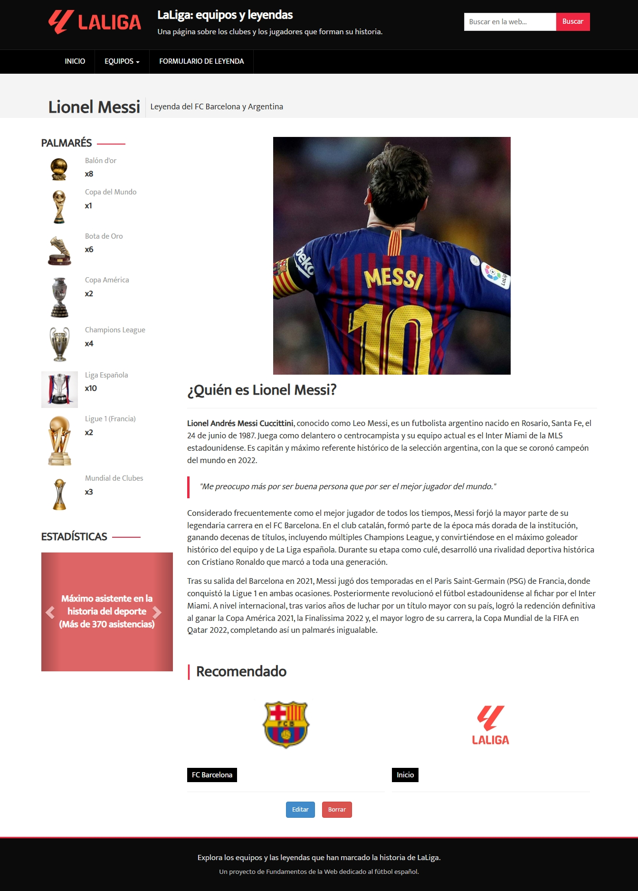
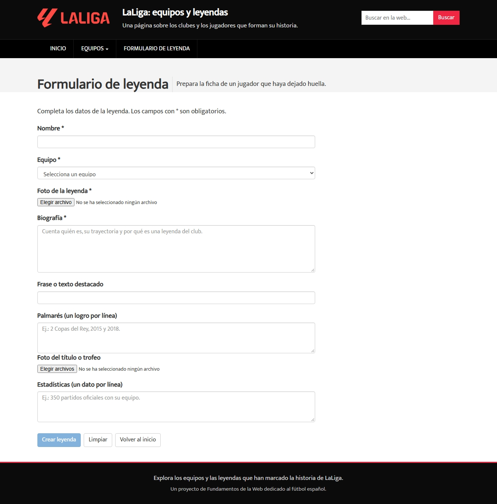

# webapp07
# LaLiga EA Sports 2026-2027

## Descripción del proyecto

Nuestra página web estará dedicada a **LaLiga EA Sports**, la Primera División del fútbol español, durante la temporada **2026-2027**.

El objetivo del proyecto es crear una página web en la que se muestren los diferentes equipos que participan en la competición y algunos datos relevantes sobre cada uno de ellos.

## Entidades

La **entidad principal** de nuestra página web será el **equipo de LaLiga** y sus atributos serán:

- Nombre del club.
- Año de fundación.
- Posición en la temporada actual.
- Temporadas jugadas en Primera División.
- Estadio.
- Ligas ganadas o mejor posición histórica en la clasificación.
- Dato curioso.

La **entidad secundaria** será el jugador del equipo y sus atributos serán:

- Nombre.
- Nacionalidad.
- Edad.
- Posición.
- Partidos jugados.
- Goles.
- Asistencias.

## Objetivo

Con esta página buscamos presentar información básica e interesante sobre los equipos de LaLiga de una forma **clara, visual y fácil de consultar**.

---

# Práctica 1

## 1. Páginas de la aplicación

En este apartado se muestran las capturas de pantalla de las diferentes páginas desarrolladas durante la práctica.
**Descripción:** [Todas las páginas usan la misma estructura de encabezado y pie de página para que la navegación sea igual en todo momento. Arriba se ve el logotipo de LaLiga, el título de la web, una breve descripción, el menú principal y un buscador. Abajo hay un texto que informa sobre la finalidad de la página y explica el contexto académico en el que se hizo. ].

### 1.1. Página principal

**Descripción:** [La página principal muestra una lista de jugadores que son leyendas de LaLiga. Hay un enlace al formulario para agregar nuevas leyendas. También incluye una tabla de la clasificación actual de los equipos, tanto puntos, como partidos jugados (Está a dia 10/10/2026 que es cuando se realizó la pagina) .].

### 1.2. Página de un equipo

**Descripción:** [La página de equipo reúne la información más importante de un club. Aquí se puede ver una descripción de su historia. También aparecen datos de la temporada actual, el entrenador, la leyenda más representativa y la plantilla de jugadores. Además, muestra la ubicación de su estadio con un mapa e imágenes relacionadas (En este docuemto solo hemos puesto la imagen de la pagina de un equipo pero existe pagina de los 20 equipos de La Liga ).].

### 1.3. Página de detalle de la leyenda

**Descripción:** [La página de detalle de leyenda se dedica a un jugador en particular. Incluye información sobre su carrera deportiva, una imagen representativa, su lista de títulos, algunos datos importantes y una breve explicación de los logros que lo han convertido en una figura importante en la historia del fútbol. (En este docuemto solo hemos puesto la imagen de la pagina de un jugador leyenda pero existe pagina de la leyenda de cada uno de los equipos de La Liga )].

### 1.4. Página de formulario de leyenda

**Descripción:** [La página de formulario de leyenda permite agregar una nueva leyenda al sitio usando un formulario. El usuario debe completar datos como el nombre del jugador, el equipo al que pertenece, una biografía, una imagen, su palmarés y algunas estadísticas importantes. Cuando llena los campos obligatorios puede dar a tres botones, añadir leyenda (Botón aun no operativo), limpiar que borra los campos del formulario que ha rellenado y cancelar que vuelve a la pagina principal.].

---

## 2. Participación de los miembros del equipo

En este apartado se detalla la contribución individual de cada miembro del equipo durante la Práctica 1.

### 2.1. [Alejandro Herranz de Galdo]

#### Tareas realizadas

- Creación del diseño y de la estructura del contenido de las páginas de la entidad principal (5 equipos de LaLiga EA Sports).
- Implementación de las fotos de los jugadores de los equipos asignados, así como la integración de los escudos y las imágenes de los estadios.
- Reestructuración del contenido eliminando páginas redundantes de la anterior plantilla.
- Colaboración en el diseño de la interfaz.
- Implementación de los botones "Editar" y "Borrar" específicos del apartado de leyendas.

#### 5 commits más significativos

1. Creación del Atlético de Madrid, tanto la información como las fotos ([ENLACE_AL_COMMIT_1](https://github.com/CodeURJC-FW-2026-27/webapp07/commit/662911dc6336096a878b42e1a4a41648021d0a11))
2. Creación del FC Barcelona, tanto la información como las fotos([ENLACE_AL_COMMIT_2](https://github.com/CodeURJC-FW-2026-27/webapp07/commit/81f1fbe920bfae0d6c177c3086d9857d9841187d))
3. Creación del Málaga FC, tanto la información como las fotos([ENLACE_AL_COMMIT_3](https://github.com/CodeURJC-FW-2026-27/webapp07/commit/977b4b61161e43b70bad428036d0615930bc9834))
4. Creación de los botones "Editar" y "Borrar" de todas las leyendas [(ENLACE_AL_COMMIT_4)](https://github.com/CodeURJC-FW-2026-27/webapp07/commit/b08e13d984879ce9acb6e67723b68c7517d62be9)
5. Borrado de una de las páginas de la anterior plantilla [(ENLACE_AL_COMMIT_5)](https://github.com/CodeURJC-FW-2026-27/webapp07/commit/98799ab8e2f2a507a8924e15befd1da655dbdb99)

#### 5 ficheros en los que más ha participado

1. atm.html [(ENLACE_AL_FICHERO_1)](https://github.com/CodeURJC-FW-2026-27/webapp07/blob/main/football_zip/atm.html)
2. barca.html [(ENLACE_AL_FICHERO_2)](https://github.com/CodeURJC-FW-2026-27/webapp07/blob/main/football_zip/barca.html)
3. rayo.html [(ENLACE_AL_FICHERO_3)](https://github.com/CodeURJC-FW-2026-27/webapp07/blob/main/football_zip/rayo.html)
4. malaga.html [(ENLACE_AL_FICHERO_4)](https://github.com/CodeURJC-FW-2026-27/webapp07/blob/main/football_zip/malaga.html)
5. betis.html [(ENLACE_AL_FICHERO_5)](https://github.com/CodeURJC-FW-2026-27/webapp07/blob/main/football_zip/betis.html)

---

### 2.2. [Neyén Alberquilla Velazquez]

#### Tareas realizadas

- Creación de la página de inicio (modificación del carousel original de la plantilla y creación de la tabla de clasificación).
- Creación de la estructura de la página de equipos (sección de información y "grids" de la plantilla del equipo).
- Modificación de cabaceras y footers generales.
- Creación de algunos clubes y leyendas.

#### 5 commits más significativos

1. Creación de la página de equipo([ENLACE_AL_COMMIT_1](https://github.com/CodeURJC-FW-2026-27/webapp07/commit/905226a2707578b84480355c17e566bebb52c22a))
2. Modificación de la página de inicio([ENLACE_AL_COMMIT_2](https://github.com/CodeURJC-FW-2026-27/webapp07/commit/5c0f2b611a15dc25cb53285e6528e0bbed016f6f))
3. Creación de equipos y leyendas([ENLACE_AL_COMMIT_3](https://github.com/CodeURJC-FW-2026-27/webapp07/commit/4ac50be7826635a9cc00c688f98585ac41543c8b))
4. Creación de la tabla de clasificación en inicio([ENLACE_AL_COMMIT_4](https://github.com/CodeURJC-FW-2026-27/webapp07/commit/e98e5874eb102b8c8cc8f5125c5269c19350fc68))
5. Header y footer general + últimos equipos y leyendas([ENLACE_AL_COMMIT_5](https://github.com/CodeURJC-FW-2026-27/webapp07/commit/aa7d2d7869c0fae7cb78f5a4ccdf2ebc7da95345))

#### 5 ficheros en los que más ha participado

1. index.html([ENLACE_AL_FICHERO_1](https://github.com/CodeURJC-FW-2026-27/webapp07/blob/main/football_zip/index.html))
2. madrid.html([ENLACE_AL_FICHERO_2](https://github.com/CodeURJC-FW-2026-27/webapp07/blob/main/football_zip/madrid.html))
3. index.css([ENLACE_AL_FICHERO_3](https://github.com/CodeURJC-FW-2026-27/webapp07/blob/main/football_zip/css/index.css))
4. equipos.css([ENLACE_AL_FICHERO_4](https://github.com/CodeURJC-FW-2026-27/webapp07/blob/main/football_zip/css/equipos.css))
5. elche.html([ENLACE_AL_FICHERO_5](https://github.com/CodeURJC-FW-2026-27/webapp07/blob/main/football_zip/elche.html))

---

### 2.3. [Ivan Gonzalez Toral]

#### Tareas realizadas

- [Describir la primera tarea realizada].
- [Describir la segunda tarea realizada].
- [Describir la tercera tarea realizada].
- [Añadir otras tareas relevantes].

#### 5 commits más significativos

1. [Descripción del commit](ENLACE_AL_COMMIT_1)
2. [Descripción del commit](ENLACE_AL_COMMIT_2)
3. [Descripción del commit](ENLACE_AL_COMMIT_3)
4. [Descripción del commit](ENLACE_AL_COMMIT_4)
5. [Descripción del commit](ENLACE_AL_COMMIT_5)

#### 5 ficheros en los que más ha participado

1. [Nombre del fichero 1](ENLACE_AL_FICHERO_1)
2. [Nombre del fichero 2](ENLACE_AL_FICHERO_2)
3. [Nombre del fichero 3](ENLACE_AL_FICHERO_3)
4. [Nombre del fichero 4](ENLACE_AL_FICHERO_4)
5. [Nombre del fichero 5](ENLACE_AL_FICHERO_5)

---

### 2.3. [Javier Martin Martin]

#### Tareas realizadas

- Realización del estilo, preguntas y diseño de la pagina de formulario.
- Realización del archivo de informacion README
- Ajuste, edición y simplificación del css global.
- Arreglo de estilos, que todo el codigo principal de estilos se encontrara en los css y no en los html.

#### 5 commits más significativos

1. Creación de la página de formulario([ENLACE_AL_COMMIT_1](https://github.com/CodeURJC-FW-2026-27/webapp07/commit/b7c9fb69e425b51236ef0f2ebd90427a45b2abe6))
2. Creación del archivo README (Dos commits principales)([ENLACE_AL_COMMIT_2.1](https://github.com/CodeURJC-FW-2026-27/webapp07/commit/0e0e9eb328b0d7148941bc16c459d2c95480bcfc))([ENLACE_AL_COMMIT_2.2](https://github.com/CodeURJC-FW-2026-27/webapp07/commit/e62733c057b607e4922c472bb9dd8d4e4c19134a))
3. Ajuste, edición y simplificación del css global([ENLACE_AL_COMMIT_3](https://github.com/CodeURJC-FW-2026-27/webapp07/commit/13c32e51b20598c1d13d9208a907f2fbc9f4055a))
4. Cambios de información en cabecera (Solo pongo dos commits pero hay mas pequeños que tambien cambian)([ENLACE_AL_COMMIT_4.1](https://github.com/CodeURJC-FW-2026-27/webapp07/commit/2ac36c5b35758bd35996b88670dbeb4b2ceaa696))([ENLACE_AL_COMMIT_4.2](https://github.com/CodeURJC-FW-2026-27/webapp07/commit/ba2d7202760cdc8222b220f1b520ca1a9cd73bcf))
5. Cambio de algunos estilos que estaban en el html a un css([ENLACE_AL_COMMIT_5](https://github.com/CodeURJC-FW-2026-27/webapp07/commit/eb2664f2b487dbeb10f04631c3b65f2e19a97b42a))

#### 5 ficheros en los que más ha participado

1. formulario-leyenda.html([ENLACE_AL_FICHERO_1](https://github.com/CodeURJC-FW-2026-27/webapp07/blob/main/football_zip/formulario-leyenda.html))
2. formulario.css([ENLACE_AL_FICHERO_2](https://github.com/CodeURJC-FW-2026-27/webapp07/blob/main/football_zip/css/formulario.css))
3. README.md([ENLACE_AL_FICHERO_3](https://github.com/CodeURJC-FW-2026-27/webapp07/blob/main/README.md))
4. global.css([ENLACE_AL_FICHERO_4](https://github.com/CodeURJC-FW-2026-27/webapp07/blob/main/football_zip/css/global.css))
5. equipos.css([ENLACE_AL_FICHERO_5](https://github.com/CodeURJC-FW-2026-27/webapp07/blob/main/football_zip/css/equipos.css))
