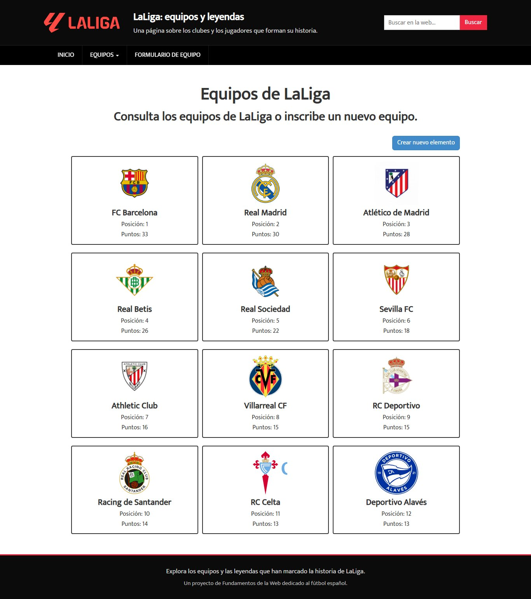
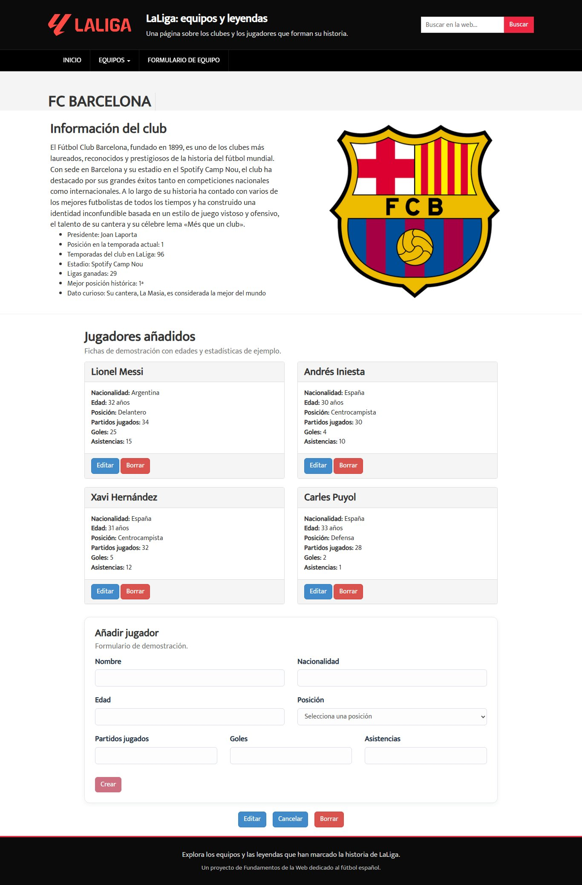
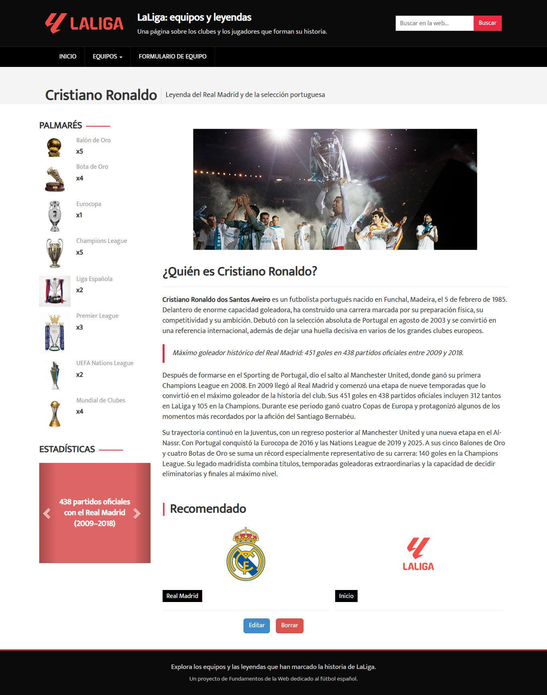
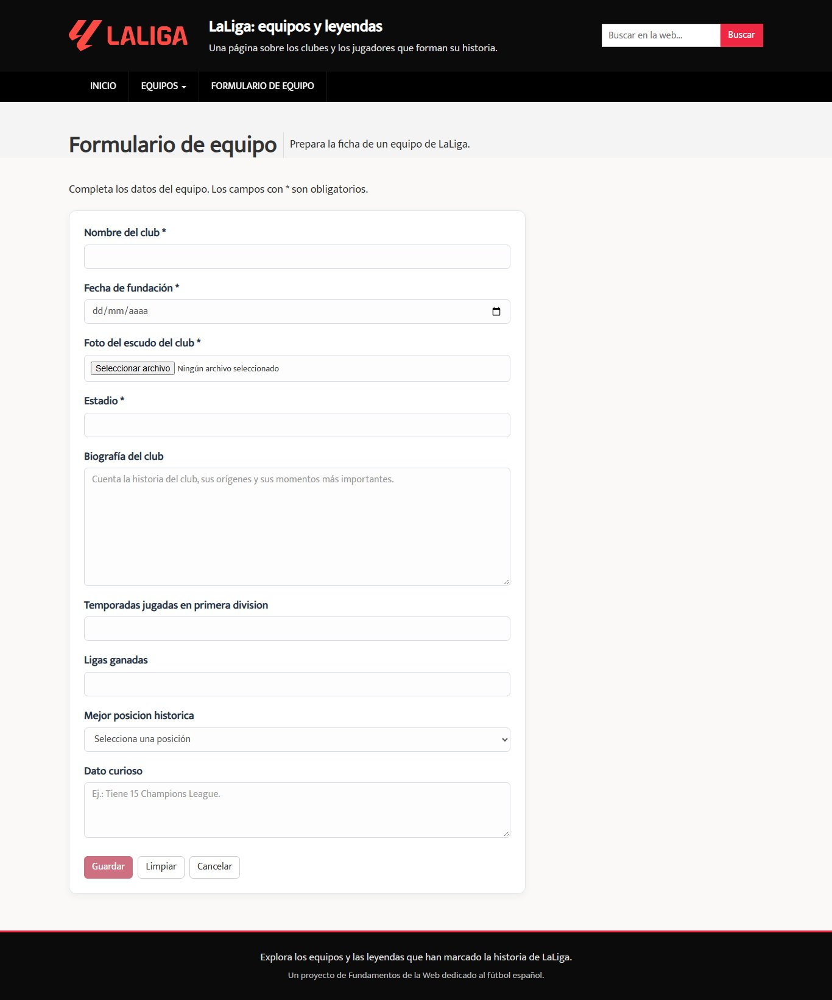

# webapp07
# LaLiga EA Sports 2026-2027

## Descripción del proyecto

Nuestra página web estará dedicada a **LaLiga EA Sports**, la Primera División del fútbol español, durante la temporada **2026-2027**.

El objetivo del proyecto es crear una página web en la que se muestren los diferentes equipos que participan en la competición y algunos datos relevantes sobre cada uno de ellos.

## Entidades

La **entidad principal** de nuestra página web será el **equipo de LaLiga** y sus atributos serán:

- Nombre del club.
- Año de fundación.
- Posición en la temporada actual.
- Temporadas jugadas en Primera División.
- Estadio.
- Ligas ganadas o mejor posición histórica en la clasificación.
- Dato curioso.

La **entidad secundaria** será el jugador del equipo y sus atributos serán:

- Nombre.
- Nacionalidad.
- Edad.
- Posición.
- Partidos jugados.
- Goles.
- Asistencias.

## Objetivo

Con esta página buscamos presentar información básica e interesante sobre los equipos de LaLiga de una forma **clara, visual y fácil de consultar**.

---

# Práctica 1

## 1. Páginas de la aplicación

En este apartado se muestran las capturas de pantalla de las diferentes páginas desarrolladas durante la práctica.
**Descripción:** [Todas las páginas usan la misma estructura de encabezado y pie de página para que la navegación sea igual en todo momento. Arriba se ve el logotipo de LaLiga, el título de la web, una breve descripción, el menú principal y un buscador. Abajo hay un texto que informa sobre la finalidad de la página y explica el contexto académico en el que se hizo. ].

### 1.1. Página principal

**Descripción:** [La página principal muestra doce equipos de LaLiga con su escudo, nombre, posición y puntos. Las tarjetas enlazan a la ficha de equipo de muestra y se distribuyen con Bootstrap en una columna en móvil, dos en tablet y tres en escritorio. Encima del listado, alineado a la derecha, aparece el enlace para crear un equipo.].

### 1.2. Página de un equipo

**Descripción:** [La ficha del FC Barcelona muestra la información del club y cuatro tarjetas de jugadores de ejemplo. Cada tarjeta incluye nombre, nacionalidad, edad, posición, partidos jugados, goles y asistencias, junto con los botones Editar y Borrar. Al final del listado aparece el formulario para añadir un jugador con esos siete atributos.].

### 1.3. Página de detalle de Cristiano Ronaldo

**Descripción:** [La página de Cristiano Ronaldo presenta su carrera deportiva, una imagen representativa, su palmarés, estadísticas y una explicación de sus logros. También incluye enlaces al equipo y a la página principal.].

### 1.4. Página de formulario de equipo

**Descripción:** [El formulario permite preparar un nuevo equipo. Nombre del club, fecha de fundación, foto del escudo y estadio son obligatorios. También incluye una biografía de siete líneas, temporadas en Primera División, ligas ganadas, mejor posición histórica y un dato curioso. Los botones Guardar y Cancelar completan el formulario.].

---

## 2. Participación de los miembros del equipo

En este apartado se detalla la contribución individual de cada miembro del equipo durante la Práctica 1.

### 2.1. [Alejandro Herranz de Galdo]

#### Tareas realizadas

- Adaptación de la página de detalle (equipo) para mostrar la información y el escudo del equipo seleccionado mediante su identificador.
- Arreglo de la organización de los equipos en la página principal, implementando los botones "Siguiente" y "Anterior" cuando supera los 6 equipos.
- Implementación de la página de error y confirmación, manteniendo el estilo de la web y los enlaces de retorno.
- Implementación del botón de "Borrar" equipos y de sus imágenes almacenadas en "uploads"
- Implementación del botón "Editar" equipos reutilizando el formulario de creación, cargando los datos actuales del equipo en el formulario.
- Traducción de los nombres internos de la práctica a inglés, manteniendo la interfaz en español.
- Solución de errores.

#### 5 commits más significativos

1. Creación del html error y sus funciones. ([ENLACE_AL_COMMIT_1](https://github.com/CodeURJC-FW-2026-27/webapp07/commit/8ad249162015f20474f2cbcc22c7cfe2d8e04929))
2. Organización de los equipos en la página principal. ([ENLACE_AL_COMMIT_2](https://github.com/CodeURJC-FW-2026-27/webapp07/commit/271cc3e1d13925eabcc9a24b207971ed69695bd8))
3. Implementación del botón "Borrar".([ENLACE_AL_COMMIT_3](https://github.com/CodeURJC-FW-2026-27/webapp07/commit/95d2f0587bb9a566603cbb4a1241434e509e84df))
4. Implementación del botón "Editar" ([(ENLACE_AL_COMMIT_4)](https://github.com/CodeURJC-FW-2026-27/webapp07/commit/7c0f7989d192d6b5a5646d091a3b776c4e4e3414))
5. Traducción a inglés ([(ENLACE_AL_COMMIT_5)](https://github.com/CodeURJC-FW-2026-27/webapp07/commit/e7c7150a0a72a0dd6af1b5f85b7aab7acba7c5fc))

#### 5 ficheros en los que más ha participado

1. src/router.js [(ENLACE_AL_FICHERO_1)](https://github.com/CodeURJC-FW-2026-27/webapp07/blob/main/football_zip/src/router.js)
2. src/board.js [(ENLACE_AL_FICHERO_2)](https://github.com/CodeURJC-FW-2026-27/webapp07/blob/main/football_zip/src/board.js)
3. views/teamForm.html [(ENLACE_AL_FICHERO_3)](https://github.com/CodeURJC-FW-2026-27/webapp07/blob/main/football_zip/views/teamForm.html)
4. views/error.html [(ENLACE_AL_FICHERO_4)](https://github.com/CodeURJC-FW-2026-27/webapp07/blob/main/football_zip/views/error.html)
5. views/team.html [(ENLACE_AL_FICHERO_5)](https://github.com/CodeURJC-FW-2026-27/webapp07/blob/main/football_zip/views/team.html)

---

### 2.2. [Neyén Alberquilla Velazquez]

#### Tareas realizadas

- Creación de la página de inicio (modificación del carousel original de la plantilla y creación de la tabla de clasificación).
- Creación de la estructura de la página de equipos (sección de información y "grids" de la plantilla del equipo).
- Modificación de cabaceras y footers generales.
- Creación de algunos clubes y leyendas.

#### 5 commits más significativos

1. Creación de la página de equipo([ENLACE_AL_COMMIT_1](https://github.com/CodeURJC-FW-2026-27/webapp07/commit/905226a2707578b84480355c17e566bebb52c22a))
2. Modificación de la página de inicio([ENLACE_AL_COMMIT_2](https://github.com/CodeURJC-FW-2026-27/webapp07/commit/5c0f2b611a15dc25cb53285e6528e0bbed016f6f))
3. Creación de equipos y leyendas([ENLACE_AL_COMMIT_3](https://github.com/CodeURJC-FW-2026-27/webapp07/commit/4ac50be7826635a9cc00c688f98585ac41543c8b))
4. Creación de la tabla de clasificación en inicio([ENLACE_AL_COMMIT_4](https://github.com/CodeURJC-FW-2026-27/webapp07/commit/e98e5874eb102b8c8cc8f5125c5269c19350fc68))
5. Header y footer general + últimos equipos y leyendas([ENLACE_AL_COMMIT_5](https://github.com/CodeURJC-FW-2026-27/webapp07/commit/aa7d2d7869c0fae7cb78f5a4ccdf2ebc7da95345))

#### 5 ficheros en los que más ha participado

1. index.html([ENLACE_AL_FICHERO_1](https://github.com/CodeURJC-FW-2026-27/webapp07/blob/main/football_zip/index.html))
2. madrid.html([ENLACE_AL_FICHERO_2](https://github.com/CodeURJC-FW-2026-27/webapp07/blob/main/football_zip/madrid.html))
3. index.css([ENLACE_AL_FICHERO_3](https://github.com/CodeURJC-FW-2026-27/webapp07/blob/main/football_zip/css/index.css))
4. equipos.css([ENLACE_AL_FICHERO_4](https://github.com/CodeURJC-FW-2026-27/webapp07/blob/main/football_zip/css/equipos.css))
5. elche.html([ENLACE_AL_FICHERO_5](https://github.com/CodeURJC-FW-2026-27/webapp07/blob/main/football_zip/elche.html))

---

### 2.3. [Ivan Gonzalez Toral]

#### Tareas realizadas

- Modificación y preparación de la cabecera de cada página para que se mantenga la misma estética en todos los archivos de forma que tenga la misma estructura (algunos detalles y funcionalidades que Neyén pulió más adelante).
- Modificación del archivo about.html haciendo borrado de cosas innecesarias e incluyendo detalles como fotos y huecos para poner el palmarés para crear la plantilla que se va a usar para cada leyenda.
- Modificación de la plantilla de unos cuantos equipos adecuando cada uno con las fotos de los jugadores, la información relevente y los enlaces a sus respectivas leyendas.
- Creación de las leyendas de varios clubes rellenando con la información adecuada a cada jugador.

#### 5 commits más significativos

1. Eliminación de elementos irrelevantes en la cabecera([ENLACE_AL_COMMIT_1](https://github.com/CodeURJC-FW-2026-27/webapp07/commit/3789abf36c1194cfddd9138e3b108913c1323065))
2. Creación de plantilla del jugador([ENLACE_AL_COMMIT_2](https://github.com/CodeURJC-FW-2026-27/webapp07/commit/f5b546e5f7394beee3557573fbe37fe1e7722604))
3. Página de la leyenda pulida con la información de Cristiano Ronaldo([ENLACE_AL_COMMIT_3](https://github.com/CodeURJC-FW-2026-27/webapp07/commit/459dae56270be606434ff5ccebb87c93db7f8b34))
4. Creción de varias leyendas de otros equipos([ENLACE_AL_COMMIT_4](https://github.com/CodeURJC-FW-2026-27/webapp07/commit/90e8d79885b5b8caf2d84be604b3fe1a31a92818))
5. Inserción de elementos requeridos en cada página([ENLACE_AL_COMMIT_5](https://github.com/CodeURJC-FW-2026-27/webapp07/commit/1ece82427d90ce32d08d1dd444a086571b5ba462))

#### 5 ficheros en los que más ha participado

1. CristianoRonaldo.html([ENLACE_AL_FICHERO_1](https://github.com/CodeURJC-FW-2026-27/webapp07/blob/main/football_zip/CristianoRonaldo.html))
2. sevilla.html([ENLACE_AL_FICHERO_2](https://github.com/CodeURJC-FW-2026-27/webapp07/blob/main/football_zip/sevilla.html))
3. FernandoTorres.html([ENLACE_AL_FICHERO_3](https://github.com/CodeURJC-FW-2026-27/webapp07/blob/main/football_zip/css/FernandoTorres.html))
4. Messi.html([ENLACE_AL_FICHERO_4](https://github.com/CodeURJC-FW-2026-27/webapp07/blob/main/football_zip/Messi.html))
5. Joaquin.html([ENLACE_AL_FICHERO_5](https://github.com/CodeURJC-FW-2026-27/webapp07/blob/main/football_zip/Joaquin.html))

---

### 2.3. [Javier Martin Martin]

#### Tareas realizadas

- Realización del estilo, preguntas y diseño de la pagina de formulario.
- Realización del archivo de informacion README
- Ajuste, edición y simplificación del css global.
- Arreglo de estilos, que todo el codigo principal de estilos se encontrara en los css y no en los html.

#### 5 commits más significativos

1. Creación de la página de formulario([ENLACE_AL_COMMIT_1](https://github.com/CodeURJC-FW-2026-27/webapp07/commit/b7c9fb69e425b51236ef0f2ebd90427a45b2abe6))
2. Creación del archivo README (Dos commits principales)([ENLACE_AL_COMMIT_2.1](https://github.com/CodeURJC-FW-2026-27/webapp07/commit/0e0e9eb328b0d7148941bc16c459d2c95480bcfc))([ENLACE_AL_COMMIT_2.2](https://github.com/CodeURJC-FW-2026-27/webapp07/commit/e62733c057b607e4922c472bb9dd8d4e4c19134a))
3. Ajuste, edición y simplificación del css global([ENLACE_AL_COMMIT_3](https://github.com/CodeURJC-FW-2026-27/webapp07/commit/13c32e51b20598c1d13d9208a907f2fbc9f4055a))
4. Cambios de información en cabecera (Solo pongo dos commits pero hay mas pequeños que tambien cambian)([ENLACE_AL_COMMIT_4.1](https://github.com/CodeURJC-FW-2026-27/webapp07/commit/2ac36c5b35758bd35996b88670dbeb4b2ceaa696))([ENLACE_AL_COMMIT_4.2](https://github.com/CodeURJC-FW-2026-27/webapp07/commit/ba2d7202760cdc8222b220f1b520ca1a9cd73bcf))
5. Cambio de algunos estilos que estaban en el html a un css([ENLACE_AL_COMMIT_5](https://github.com/CodeURJC-FW-2026-27/webapp07/commit/eb2664f2b487dbeb10f04631c3b65f2e19a97b42a))

#### 5 ficheros en los que más ha participado

1. formulario-leyenda.html([ENLACE_AL_FICHERO_1](https://github.com/CodeURJC-FW-2026-27/webapp07/blob/main/football_zip/formulario-leyenda.html))
2. formulario.css([ENLACE_AL_FICHERO_2](https://github.com/CodeURJC-FW-2026-27/webapp07/blob/main/football_zip/css/formulario.css))
3. README.md([ENLACE_AL_FICHERO_3](https://github.com/CodeURJC-FW-2026-27/webapp07/blob/main/README.md))
4. global.css([ENLACE_AL_FICHERO_4](https://github.com/CodeURJC-FW-2026-27/webapp07/blob/main/football_zip/css/global.css))
5. equipos.css([ENLACE_AL_FICHERO_5](https://github.com/CodeURJC-FW-2026-27/webapp07/blob/main/football_zip/css/equipos.css))

# Práctica 2

## 1. Instrucciones de ejecución

### Requisitos previos

- Instalar Mongo Bd desde su pagina original
- En la terminal de football-zip, instala las dependencias: `npm install`

### Iniciar y finalizar

En la terminal de football-zip arranca el servidor web:
`npm run watch`

Abre [http://localhost:3000](http://localhost:3000) en el navegador. 
Para detener la aplicación, pulsa `Ctrl+C` en la terminal donde se ejecuta `npm run watch`.

## 2. Descripción de ficheros

Los ficheros creados o modificados por el equipo para implementar la aplicación se organizan así:

- **package.json**: dependencias y comandos de ejecución (`npm start` y `npm run watch`).
- **app.js**: crea y configura Express, Mustache, los ficheros estáticos, el análisis de formularios y el puerto 3000.
- **router.js**: define las rutas, prepara los datos de las vistas y gestiona equipos, jugadores, búsquedas, filtros, formularios y errores.
- **board.js**: acceso a MongoDB y operaciones de consulta, creación, edición y borrado de equipos y jugadores; también gestiona las imágenes subidas.
- **load_data.js**: crea el directorio de subidas y carga los datos de demostración cuando la base de datos no contiene equipos.
- **/views**: plantillas Mustache de las páginas y componentes compartidos: index.html, equipo.html, formularioEquipo.html, header.html, footer.html, confirmacion.html y error.html.
- **/css**: hojas de estilo de la interfaz (global.css, index.css, equipos.css, formulario.css, tarjetas-equipos.css y estilos auxiliares). También contiene Bootstrap y otros estilos de terceros.
- **/public**: archivos estaticos empleados en la pagina
- **/data**: Datos de demostracion de añadido inicial referenciados por data.json.
- **/uploads**: destino de las imágenes  cargadas mediante el formulario.
- **.gitignore**: excluye dependencias instaladas e imágenes subidas del control de versiones.

## 3. Vídeo demostrativo

Vídeo de YouTube (duración mínima: 1 minuto) mostrando la funcionalidad de la aplicación: **[ENLACE AL VÍDEO](https://youtu.be/N9QVDtXqxjc)**.

## 4. Participación de los miembros del equipo

En este apartado se detalla la contribución individual de cada miembro del equipo durante la Práctica 1.

### 4.1. [Alejandro Herranz de Galdo]

#### Tareas realizadas

- Adaptación de la página detalle (página del equipo) para mostrar la información (atributos) y el escudo del equipo seleccionado mediante su identificador.
- Creación de la página error y sus funciones, manteniendo el estilo de la web y los enlaces de retorno.
- Corrección de la distribución de los equipos en la página principal e implementación de los botones "Siguiente" y "Anterior" cuando existen más de 6 equipos.
- Implementación del botón "Borrar" en equipos y sus imágenes almacenadas en la carpeta "uploads"
- Implementación del botón "Editar" reutilizando el formulario de creación, cargando los valores anteriores del equipo.
- Traducción de los nombres internos de la práctica a inglés, manteniendo la interfaz en español.

#### 5 commits más significativos

1. Adaptación de la página detalle. [(ENLACE_AL_COMMIT_1)](https://github.com/CodeURJC-FW-2026-27/webapp07/commit/27a8906cd6f2bad2b74a97ef7d35b6359f42d712).
2. Creación de la página error [(ENLACE_AL_COMMIT_2)](https://github.com/CodeURJC-FW-2026-27/webapp07/commit/8ad249162015f20474f2cbcc22c7cfe2d8e04929)
3. Implementación del botón "Borrar" en equipos. [(ENLACE_AL_COMMIT_3)](https://github.com/CodeURJC-FW-2026-27/webapp07/commit/95d2f0587bb9a566603cbb4a1241434e509e84df)
4. Implementación del botón "Editar" [(ENLACE_AL_COMMIT_4)](https://github.com/CodeURJC-FW-2026-27/webapp07/commit/7c0f7989d192d6b5a5646d091a3b776c4e4e3414)
5. Traducción a inglés. [(ENLACE_AL_COMMIT_5)](https://github.com/CodeURJC-FW-2026-27/webapp07/commit/42b2adfbedfdf67a6dfe5d8909e101491498ab66)

#### 5 ficheros en los que más ha participado

1. views/error.html [(ENLACE_AL_FICHERO_1)](https://github.com/CodeURJC-FW-2026-27/webapp07/blob/main/football_zip/views/error.html)
2. src/router.js [(ENLACE_AL_FICHERO_2)](https://github.com/CodeURJC-FW-2026-27/webapp07/blob/main/football_zip/src/router.js)
3. src/board.js [(ENLACE_AL_FICHERO_3)](https://github.com/CodeURJC-FW-2026-27/webapp07/blob/main/football_zip/src/board.js)
4. views/team.html [(ENLACE_AL_FICHERO_4)](https://github.com/CodeURJC-FW-2026-27/webapp07/blob/main/football_zip/views/team.html)
5. views/teamForm.html [(ENLACE_AL_FICHERO_5)](https://github.com/CodeURJC-FW-2026-27/webapp07/blob/main/football_zip/views/teamForm.html)

---

### 4.2. [Neyén Alberquilla Velazquez]

#### Tareas realizadas

- Corrección total de la estructura errónea propuesta en la Práctica 1 para poder implementar correctamente la Práctica 2.
- Organización del proyecto en las carpetas que dicta la teoría subida por el docente.
- Ceración de las plantillas base de las vistas HTML con Mustache (index, team, teamForm, header, footer)
- Creación de la lógica base del router.js y de la implementación inicial.
- Creación de la estructura de mostrado de los equipos en index.
- Creación de la lógica de inserción y mostrado de equipos en la BD.
- Modificación y tratado del formulario de nuevo equipo.
- Creación de la lógica de mostrado, creación, editado e implementación total de los jugadores de cada equipo.

#### 5 commits más significativos

1. Modificación y creación inicial de las plantillas HTML Mustache ([ENLACE_AL_COMMIT_1](https://github.com/CodeURJC-FW-2026-27/webapp07/commit/c25da0579ee9f96b70eef2671f072ecea8b1a382))
2. Terminado de la implementación inicial del form de creación de equipos y guardado en la BD([ENLACE_AL_COMMIT_2](https://github.com/CodeURJC-FW-2026-27/webapp07/commit/bebde3e41179de706770434849ff8d96913a81e4))
3. Terminado de la implementación de creación de jugadores y guardado en la BD([ENLACE_AL_COMMIT_3](https://github.com/CodeURJC-FW-2026-27/webapp07/commit/4a66a155383113635d87c54b27642d7bb1ebfbdb))
4. Implementación de la comprobación para añadir jugadores([ENLACE_AL_COMMIT_4](https://github.com/CodeURJC-FW-2026-27/webapp07/commit/6b65da64898f8d126b765178197166b06e313cac))
5. Correcciones finales respecto a la reutilización de código para la creación de jugadores y tratado de errores([ENLACE_AL_COMMIT_5](https://github.com/CodeURJC-FW-2026-27/webapp07/commit/7297a45b0b6eb4eb43b12776b0f445495e4dfeb0))

#### 5 ficheros en los que más ha participado

1. router.js([ENLACE_AL_FICHERO_1](https://github.com/CodeURJC-FW-2026-27/webapp07/blob/main/football_zip/src/router.js))
2. index.html([ENLACE_AL_FICHERO_2](https://github.com/CodeURJC-FW-2026-27/webapp07/blob/main/football_zip/views/index.html))
3. team.html([ENLACE_AL_FICHERO_3](https://github.com/CodeURJC-FW-2026-27/webapp07/blob/main/football_zip/views/team.html))
4. teamForm.html([ENLACE_AL_FICHERO_4](https://github.com/CodeURJC-FW-2026-27/webapp07/blob/main/football_zip/views/teamForm.html))
5. app.js([ENLACE_AL_FICHERO_5](https://github.com/CodeURJC-FW-2026-27/webapp07/blob/main/football_zip/src/app.js))

---

### 4.3. [Ivan Gonzalez Toral]

#### Tareas realizadas

- Arreglo de datos de los equipos que no se mostraban debidamente en pantalla.
- Limpieza de elementos innecesarios como fotos y código que no servía para nada ya que la práctica 1 no se hizo como se debía
- Implementación del buscador en la cabecera para buscar equipos guardados en la base de datos.
- Grabación del video explicativo de la funcionalidad de la página

#### 3 commits más significativos

1. Arreglo de detalles de equipos([ENLACE_AL_COMMIT_1](https://github.com/CodeURJC-FW-2026-27/webapp07/commit/ad5cdf8cf9299c8fa773cbf80bf6f081a8dc0f1e))
2. Limpieza de cosas que no servían([ENLACE_AL_COMMIT_2](https://github.com/CodeURJC-FW-2026-27/webapp07/commit/6d56ab728cda69a8b109356a35dd50fde5cab2c1))
3. Implementación del buscador([ENLACE_AL_COMMIT_3](https://github.com/CodeURJC-FW-2026-27/webapp07/commit/a572add6f706f4524a3334602923aff0fe4202d6))

#### 4 ficheros en los que más ha participado

1. header.html([ENLACE_AL_FICHERO_1](https://github.com/CodeURJC-FW-2026-27/webapp07/blob/main/football_zip/views/header.html))
2. router.js([ENLACE_AL_FICHERO_2](https://github.com/CodeURJC-FW-2026-27/webapp07/blob/main/football_zip/src/router.js))
3. team.html([ENLACE_AL_FICHERO_3](https://github.com/CodeURJC-FW-2026-27/webapp07/blob/main/football_zip/views/team.html))
4. carpeta img ([ENLACE_AL_FICHERO_4](https://github.com/CodeURJC-FW-2026-27/webapp07/tree/main/football_zip/public/img))

---

### 4.4. [Javier Martin Martin]

#### Tareas realizadas

- Creacion de la base de datos en MongoBD.
- Carga automatica de archivos con el Load data.
- Creacion de sistema de filtrado.
- Ajuste de las dependencias y del npm para el comienzo de la practica

#### 5 commits más significativos

1. Creación automatica de archivos con el load data ([ENLACE_AL_COMMIT_1](https://github.com/CodeURJC-FW-2026-27/webapp07/commit/d6dd2c1f7063cce767b5aedd0e81a42a49759647))
2. Creación y completado del archivo board.js  (Dos commits principales)([ENLACE_AL_COMMIT_2.1](https://github.com/CodeURJC-FW-2026-27/webapp07/commit/011eb05f3b1c424a310062c7bf7e3d0858e321f2))([ENLACE_AL_COMMIT_2.2](https://github.com/CodeURJC-FW-2026-27/webapp07/commit/cd48b8831d709a2dcdca776caa6a396d1f160b9f))
3. Completado del archivo de información de la práctica readme.md ([ENLACE_AL_COMMIT_3](https://github.com/CodeURJC-FW-2026-27/webapp07/commit/0a94e8c0c86e381c0518910f2c3708dbb9411c76))
4. Filtrado por categoria ([ENLACE_AL_COMMIT_4](https://github.com/CodeURJC-FW-2026-27/webapp07/commit/792bdc8d5e228abd7680b212dea2440553ae4266))
5. Ajuste de las dependencias (Dos commits principales) ([ENLACE_AL_COMMIT_5.1](https://github.com/CodeURJC-FW-2026-27/webapp07/commit/5f7e71b89593df06e4ad96ef77dd0d5194d41f96))([ENLACE_AL_COMMIT_5.2](https://github.com/CodeURJC-FW-2026-27/webapp07/commit/92618f31aaae24a8f8b02b45eab37d1e6512ba2a))

#### 5 ficheros en los que más ha participado

1. board.js ([ENLACE_AL_FICHERO_1](https://github.com/CodeURJC-FW-2026-27/webapp07/blob/main/football_zip/src/board.js))
2. load_data.js ([ENLACE_AL_FICHERO_2](https://github.com/CodeURJC-FW-2026-27/webapp07/blob/main/football_zip/src/load_data.js))
3. router.js ([ENLACE_AL_FICHERO_3](https://github.com/CodeURJC-FW-2026-27/webapp07/blob/main/football_zip/src/router.js))
4. data.json ([ENLACE_AL_FICHERO_4](https://github.com/CodeURJC-FW-2026-27/webapp07/blob/main/football_zip/data/data.json))
5. index.html ([ENLACE_AL_FICHERO_5](https://github.com/CodeURJC-FW-2026-27/webapp07/blob/main/football_zip/views/index.html))
